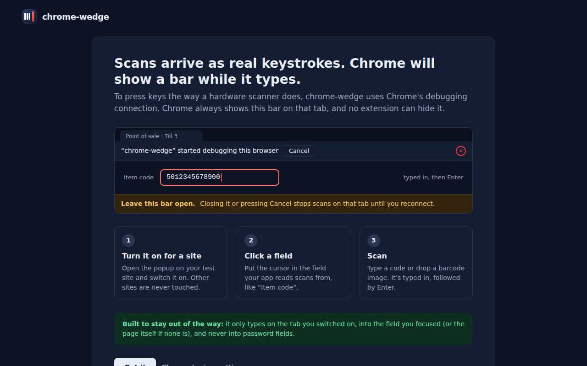

<!-- about -->

# chrome-wedge

**Type or drop a barcode and it arrives as real keystrokes, like a hardware scanner**

## Screens

### S01 · Popup

Send a scan (typed, dropped image or saved code) into the focused field of the current tab

### S02 · Welcome and debugging bar explanation

Explain, before the first scan, why Chrome shows a debugging bar and how to scan safely

### S03 · Settings

Set how scans are typed, which sites are allowed, and the saved codes

<!-- /about -->

## Development

- Requirements: Node 22, Chrome 118+.
- Setup: `npm install`, `npx playwright install chromium`.
- Build: `npm run build` (output in `dist/`), `npm run dev` (rebuild on change).
- Load unpacked: open `chrome://extensions`, turn on Developer mode, choose Load unpacked, pick `dist/`. After a rebuild, press the reload icon on the extension card.
- Checks: `npm run format:check`, `npm run typecheck`, `npm test`, `npm run build && npm run e2e`. `npm run format` fixes formatting.
- Icons: `npm run icons` regenerates `public/icons/` from `design/brand/mark.svg`.

---

Created with ❤️ by Dunder Mifflin agents
