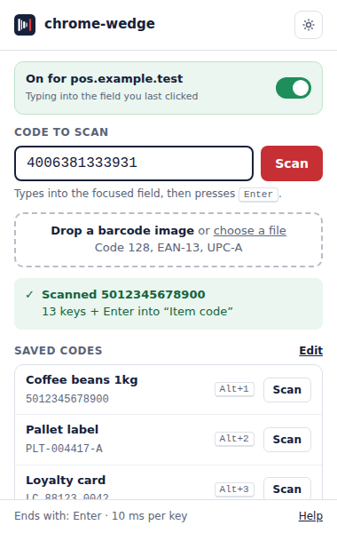
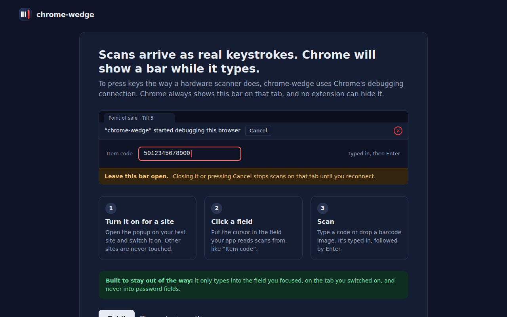
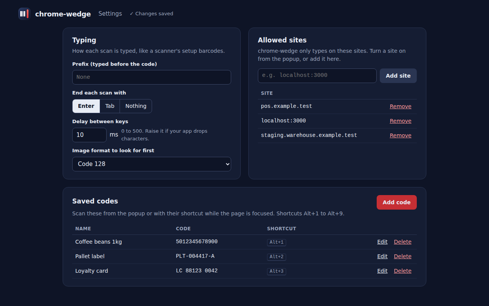

<!-- about -->
# chrome-wedge

**Type or drop a barcode and it arrives as real keystrokes, like a hardware scanner**

## Screens

### S01 · Popup

Send a scan (typed, dropped image or saved code) into the focused field of the current tab

### S02 · Welcome and debugging bar explanation

Explain, before the first scan, why Chrome shows a debugging bar and how to scan safely

### S03 · Settings

Set how scans are typed, which sites are allowed, and the saved codes

<!-- /about -->

## Development

TODO: build and test instructions, added with the first code.

---

Created with ❤️ by Dunder Mifflin agents
