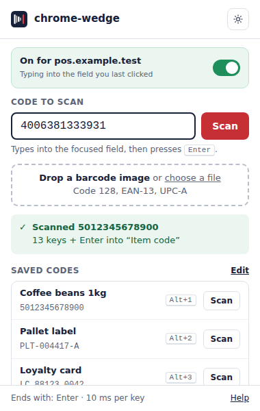
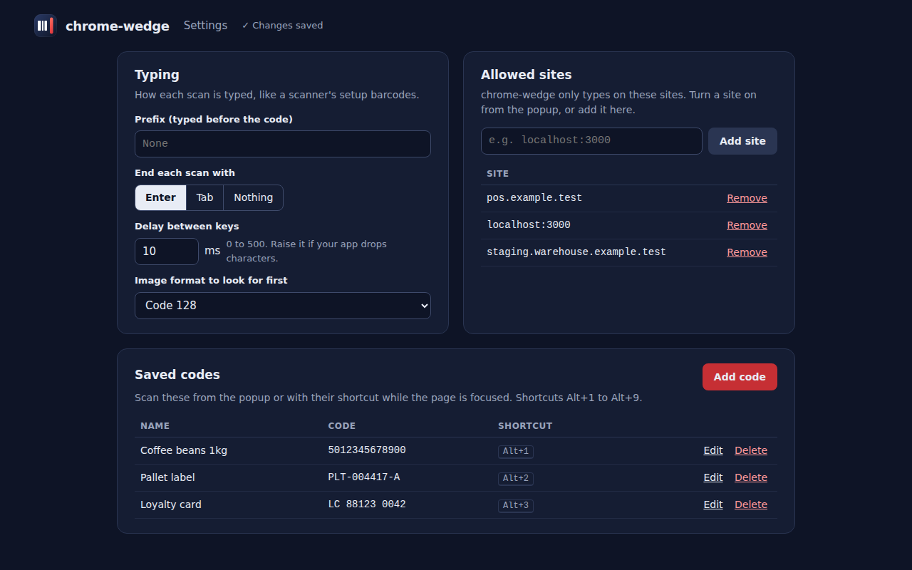

<!-- about -->

# chrome-wedge

**Type or drop a barcode and it arrives as real keystrokes, like a hardware scanner**

## Screens

### S01 · Popup

Send a scan (typed, dropped image or saved code) into the focused field of the current tab

### S02 · Welcome and debugging bar explanation

Explain, before the first scan, why Chrome shows a debugging bar and how to scan safely

### S03 · Settings

Set how scans are typed, which sites are allowed, and the saved codes

<!-- /about -->

## Saved-code shortcuts

On a switched-on page, Alt+1 … Alt+9 send the saved code with that shortcut into the focused field. Alt+Shift+1 … Alt+Shift+9 do the same, for Linux and other systems where the browser or the window manager takes Alt+digit. Tabs that are not switched on get no shortcut listener. Linux Alt+digit: not verified in the sandbox (no `xdotool`); needs a by-hand check on Linux.

## Development

- Requirements: Node 22, Chrome 118+.
- Setup: `npm install`, `npx playwright install chromium`.
- Build: `npm run build` (output in `dist/`), `npm run dev` (rebuild on change).
- Load unpacked: open `chrome://extensions`, turn on Developer mode, choose Load unpacked, pick `dist/`. After a rebuild, press the reload icon on the extension card.
- Checks: `npm run format:check`, `npm run typecheck`, `npm test` (unit tests with coverage; fails under 90% on `src/core/`), `npm run build && npm run e2e`. `npm run format` fixes formatting.
- Secret scan: `betterleaks git --redact --verbose --log-opts="--full-history --all --diff-filter=tuxdb --diff-merges=first-parent" .` scans the full git history, including merge-commit patches (CI runs it on every pull request into `develop` with betterleaks 1.10.1, pinned in `.github/workflows/ci.yml`). Install the matching release binary from https://github.com/betterleaks/betterleaks/releases.
- Test fixtures: `npm run fixtures` regenerates `test/fixtures/barcodes/` (barcode PNGs and `index.json`) with bwip-js; commit the output.
- Icons: `npm run icons` regenerates `public/icons/` from `design/brand/mark.svg`.

---

Created with ❤️ by Dunder Mifflin agents
